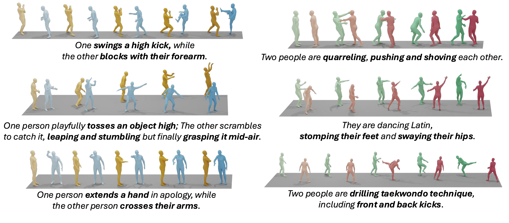

# Text2Interact
Text2Interact: High-Fidelity and Diverse Text-to-Two-Person Interaction Generation (ICLR 2026)

## Introduction
Official code of the paper [Text2Interact: High-Fidelity and Diverse Two-Person Interaction Generation from Text](https://arxiv.org/abs/2510.06504) (ICLR 2026).

[[Project Page]](https://frank-zy-dou.github.io/projects/Text2Interact/index.html) [[Paper]](https://arxiv.org/abs/2510.06504) [[Video]](https://www.youtube.com/watch?v=-zT1Arynx8Q)



Abstract: Modeling human–human interactions from text remains challenging because it requires not only realistic individual dynamics but also precise, text-consistent spatiotemporal coupling between agents. Currently, progress is hindered by 1) *limited two-person training data*, inadequate to capture the diverse intricacies of two-person interactions; and 2) insufficiently fine-grained text-to-interaction modeling, where language conditioning collapses rich, structured prompts into a single sentence embedding. To address these limitations, we propose our Text2Interact framework, designed to generate realistic, text-aligned human–human interactions through a scalable high-fidelity interaction data synthesizer and an effective spatiotemporal coordination pipeline. First, we present InterCompose, a scalable synthesis-by-composition pipeline that aligns LLM-generated interaction descriptions with strong single-person motion priors. Given a prompt and a motion for an agent, InterCompose retrieves candidate single-person motions, trains a conditional reaction generator for another agent, and uses a neural motion evaluator to filter weak or misaligned samples—expanding interaction coverage without extra capture. Second, we propose InterActor, a text-to-interaction model with word-level conditioning that preserves token-level cues (initiation, response, contact ordering) and an adaptive interaction loss that emphasizes contextually relevant inter-person joint pairs, improving coupling and physical plausibility for fine-grained interaction modeling. Extensive experiments show consistent gains in motion diversity, fidelity, and generalization, including out-of-distribution scenarios and user studies.

## Inference

### Environment Preparation

This project renders generated motion to `.mp4` using matplotlib's
`FFMpegFileWriter`, which invokes the **`ffmpeg`** binary at runtime. `ffmpeg` is a
system-level dependency (**not** a pip package), so it is installed with conda
**before** the Python requirements. Full details are in [`ENV.md`](ENV.md).

Prerequisites:
- [conda](https://docs.conda.io/) (miniconda or anaconda)
- An NVIDIA GPU with a CUDA 11.7-compatible driver (the pinned PyTorch build is `+cu117`)

```bash
# 1. Create the environment (Python 3.8)
conda create -n text2interact python=3.8 -y

# 2. Install ffmpeg via conda — REQUIRED for .mp4 rendering, install before pip
conda install -n text2interact -c conda-forge ffmpeg -y

# 3. Install the Python dependencies
conda run -n text2interact pip install -r requirements.txt
```

### Dependency Files
- **Checkpoint**: place the trained checkpoint at the path set by `CHECKPOINT:` in the
  model config (`configs/model-finetune-0.35.yaml`, default `checkpoints/finetune-0.35.ckpt`).
  The `checkpoints/` directory is not version-controlled.
  Download it from [Google Drive](https://drive.google.com/file/d/1BbOHZzHAB2fUQfbaqiJLUOvO8WU0rxuO/view?usp=sharing).
- **CLIP weights** (`ViT-L/14@336px`) download automatically on first run.
- **Normalization statistics** (`data/global_mean.npy`, `data/global_std.npy`) are
  committed to the repository.

### Usage

To run inference:

```bash
conda activate text2interact
python tools/infer.py                          # uses configs/model-finetune-0.35.yaml
python tools/infer.py --cfg <model.yaml>       # use a different model config
```

- **Prompts**: one per line in `custom_prompts.txt`. The output filename is the first
  48 characters of the prompt.
- **Output**: rendered videos are written to `results/<prompt>.mp4` (not git-tracked).

## Citation
```
@inproceedings{wu2026text2interact,
  title={Text2Interact: High-Fidelity and Diverse Two-Person Interaction Generation from Text},
  author={Wu, Qingxuan and Dou, Zhiyang and Guo, Chuan and Huang, Yiming and Feng, Qiao and Zhou, Bing and Wang, Jian and Liu, Lingjie},
  booktitle={The Fourteenth International Conference on Learning Representations (ICLR)},
  year={2026}
}
```

## Acknowledgements
Our implementation and experiments are built on top of open-source GitHub repositories.
We thank all the authors who made their code public.

[tr3e/intergen (InterGen)](https://github.com/tr3e/intergen)

[openai/guided-diffusion](https://github.com/openai/guided-diffusion)
